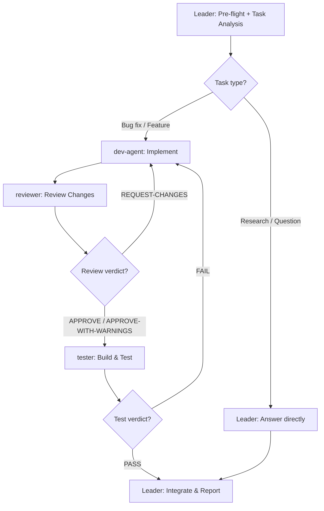

# Workflow: MachineIdBar Development Pipeline

## Overview



## Detailed Steps

### Step 0 — Pre-flight: dependency check

- **Executor**: Leader
- **Input**: [dependencies.yaml](dependencies.yaml)
- **Action**: verify Python, PyInstaller, and any skills/tools are available
- **Output**: pre-flight report to user
- **Quality gate**: user decides go/no-go on missing items (Agent does NOT auto-decide)

### Step 1 — Task analysis

- **Executor**: Leader
- **Input**: user request (bug report, feature request, or question)
- **Action**: classify the request. If it requires code changes → proceed to Step 2. If it is a question or research task → answer directly and skip to Step 5.
- **Output**: task classification (feature / bugfix / refactor / question) and a 1-line task description for teammates
- **Quality gate**: task description is specific enough that dev-agent can implement without guessing — if not, ask the user for clarification before dispatching

### Step 2 — Implementation

- **Executor**: dev-agent
- **Input**: task description + current source files (`machine_id_bar.py`, `setup.py`)
- **Action**: read existing code, implement the change, output unified diff or modified functions
- **Output**: Changes Made + Rationale + Modified Code per dev-agent Output Schema
- **Serial**: single role
- **Quality gate**: output matches dev-agent Output Schema with at least one change entry and a diff block. If output is malformed or empty → re-dispatch once with schema inlined. On 2nd failure → mark `[DEV-AGENT MISSING]` and report to user.

### Step 3 — Code review

- **Executor**: reviewer
- **Input**: dev-agent's diff + full source files
- **Action**: review changes for correctness, Windows API safety, RDP edge cases, thread safety
- **Output**: Findings + Windows API Check + Verdict per reviewer Output Schema
- **Serial**: single role, runs after dev-agent
- **Quality gate**: verdict is one of {APPROVE, APPROVE-WITH-WARNINGS, REQUEST-CHANGES}. At least 3 findings present. If verdict is REQUEST-CHANGES → loop back to Step 2 with reviewer's findings as additional input. Max 2 review rounds before escalating to user.

### Step 4 — Build & test

- **Executor**: tester
- **Input**: reviewed source code + project directory path
- **Action**: run PyInstaller build, launch the exe, test clipboard copy, test resolution change handling
- **Output**: Build Result + Launch Test + Functional Tests + Verdict per tester Output Schema
- **Serial**: single role, runs after reviewer approves
- **Quality gate**: verdict is PASS. If FAIL → loop back to Step 2 with tester's failure details. Max 2 build/test rounds before escalating to user.

### Step 5 — Final: emit Development Report

- **Executor**: Leader
- **Input**: outputs from all completed steps
- **Action**: integrate all outputs into a single report. Surface any reviewer warnings verbatim. If the loop hit max retries, surface the unresolved issue to the user.
- **Output**: Development Report in the format below

#### Final Report Format

```markdown
# Development Report

## Summary
<1-3 sentence overview of what was done>

## Changes
- [file:line] description — implemented by dev-agent

## Review Findings
- [severity] [file:line] finding — by reviewer
- Review verdict: APPROVE / APPROVE-WITH-WARNINGS

## Test Results
- Build: PASS / FAIL
- Clipboard: PASS / FAIL
- Resolution change: PASS / FAIL / SKIPPED
- Overall: PASS / FAIL

## Warnings
- <any warnings from reviewer or tester, verbatim>

## Next Steps
- <suggested follow-up actions for the user>
```

## Acceptance Criteria

- All dispatched roles returned outputs matching their `## Output Schema` (no malformed responses).
- Final Report contains all mandatory sections (Summary, Changes, Review Findings, Test Results).
- If review verdict was REQUEST-CHANGES, the loop back to dev-agent is recorded in the report.
- If test verdict was FAIL, the loop back to dev-agent is recorded in the report.
- No more than 2 review rounds and 2 test rounds were executed (beyond that, the issue is surfaced to the user).
